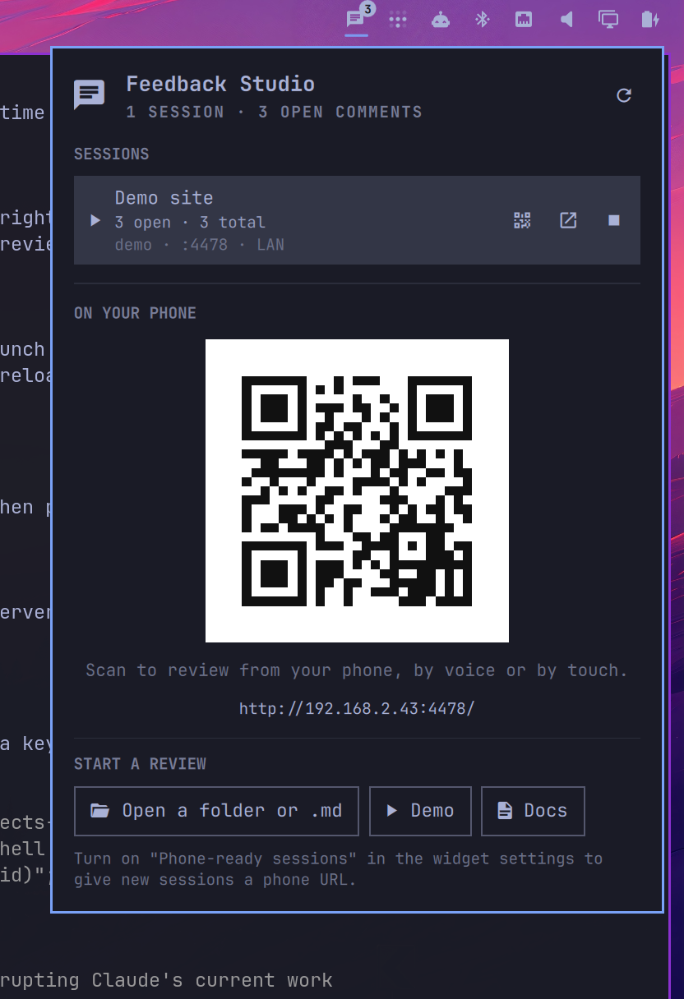

# Feedback Studio for Omarchy

[Feedback Studio](https://github.com/baskb/feedback-studio) overlays a local
website you're building, or a Markdown file you're writing, so you can click
any element, select any sentence, and say what should change, typed or spoken,
from your desk or from your phone. Your coding agent then applies the comments
when you say **PPF** (Please Process Feedback).

This plugin puts it in the **Omarchy bar**:



- **One icon, one number, one dot.** The icon lights up while a review server
  runs and shows how many comments are still open. A dot in the corner means a
  coding agent is on a session; it pulses while the agent works on a comment.
  The badge turns urgent when a question has waited too long with no agent.
- **Every session at a glance.** Label or project, open / resolved / total
  counts (and how many wait for *you*: answered questions, queued changes),
  mode (static site, dev server, Markdown, demo), port, what the coding agent
  is doing right now ("Claude is on a comment · editing src/Header.jsx"), the
  latest thing that happened ("resolved #4 · 2m ago"), and whether Claude
  Code is already open in that project.
- **Notifications that say what was said.** A new comment becomes a desktop
  toast with its type and text ("Question · Demo: Ann: “Where does this
  button lead?” · 4 open"). Click it to open the page, or, by setting, to
  send the session to Claude Code. When an agent leaves after a round you get
  "Round done · 3 comments applied · 1 open". A question nobody answers for
  ten minutes gets one critical toast whose click starts Claude Code in watch
  mode.
- **Review from your phone, privately.** Set phone access to **Tailscale** and
  new sessions are reachable from a phone on your tailnet with a real
  certificate, nothing leaves the tailnet. Or use a Cloudflare tunnel for any
  network. One click shows the QR code.
- **Hand a session to Claude Code.** One button opens Claude Code in the
  project with "Please process feedback", or focuses the Claude Code window
  that is already there.
- **Screenshot comments.** Select a region of the screen and it becomes a
  comment with the picture attached, for visual bugs that are hard to pin by
  clicking.
- **Start a review without a terminal.** Open a project folder or a `.md` file
  through a picker, review the project of the focused terminal window, restart
  one of the last five reviewed projects, or try the bundled demo. The server's
  banner stays visible in its own terminal window; Ctrl+C ends the session.
- **Keyboard first**, like the rest of the Omarchy shell: `Super+Shift+F` (see
  below), then arrows, Enter to open, `Q` QR code, `P` process with Claude
  Code, `W` watch mode, `S` screenshot comment, `L` server log, `H` this
  window, `D` demo, `O` picker, `R` refresh.

## Requirements

- **Omarchy 4.0 or newer.** Shell plugins arrived in 4.0 "Quattro".
- **Node.js 18 or newer.** Omarchy does not install it; mise does, in one line:

  ```
  mise use -g node@lts
  ```

  The widget tells you when Node is missing. Feedback Studio itself is fetched
  from npm on first use (`npx -y feedback-studio@1`) and needs **1.3.0 or
  newer**, the first release that registers its sessions for this widget.
- `jq`, `curl`, `gum`, `qrencode`, `grim`, `slurp`, ImageMagick, and `wl-copy`
  ship with Omarchy. `tailscale` only for the Tailscale phone option; `claude`
  (Claude Code) only for the hand-off buttons.

## Install

```
omarchy plugin add https://github.com/baskb/omarchy-feedback-studio --enable
```

Or from the Omarchy menu: **Setup → Plugins → Add Plugin**, paste the URL, then
**Enable Plugin**. The widget lands in the right section of the bar; move it with

```
omarchy bar move baskb.feedback-studio --section right
```

### Hotkey

Add to `~/.config/hypr/bindings.lua`:

```lua
o.bind("SUPER + SHIFT + F", "Feedback Studio", "omarchy-shell shell toggle baskb.feedback-studio")
```

### Menu entries (optional)

Add to `~/.config/omarchy/extensions/omarchy-menu.jsonc`:

```jsonc
"feedback": {"icon":"󰍩","label":"Feedback Studio","aliases":["feedback","review","ppf"]},
"feedback.panel": {"icon":"󰍩","label":"Sessions","action":"omarchy-shell shell toggle baskb.feedback-studio"},
"feedback.pick": {"icon":"󰝰","label":"Review a folder or .md","action":"bash ~/.config/omarchy/plugins/baskb.feedback-studio/bin/fbs-launch pick"},
"feedback.here": {"icon":"󰖲","label":"Review this window's project","action":"bash ~/.config/omarchy/plugins/baskb.feedback-studio/bin/fbs-here"},
"feedback.demo": {"icon":"󰐊","label":"Try the demo","action":"bash ~/.config/omarchy/plugins/baskb.feedback-studio/bin/fbs-launch demo"},
```

A global binding for "review whatever is in front of me" (a terminal's folder,
else the picker):

```lua
o.bind("SUPER + SHIFT + R", "Review this project", "omarchy-shell baskb.feedback-studio here")
```

## Using it

| Where | Action |
|---|---|
| Bar icon, left click | Open the panel |
| Bar icon, middle click | Open the newest session in the browser |
| Bar icon, right click | Refresh |
| Session row, click or Enter | Open that session in the browser |
| 󰐲 on a row, or `Q` | Show a QR code for the session's phone URL (greyed out when the session is local only) |
| 󰏌 on a row | Open in the browser |
| 󰓛 on a row | Stop the session. Comments stay in the project's `.feedback/` folder |
| Hover a row: **Claude**, or `P` (`W` for watch mode) | Open Claude Code in the project and ask it to process the feedback, or focus the Claude Code window already open there. Hidden while an agent is on the session |
| Hover a row: **Screenshot**, or `S` | Select a screen region, type what should change, and post it as a comment with the picture attached |
| Hover a row: **Log**, or `L` | Bring the server's terminal window to the front |
| Hover a row: **Copy report** | Copy `.feedback/REPORT.md` to the clipboard (shown once the report skill wrote one) |
| **Open a folder or .md**, or `O` | A terminal opens with a picker. Choose a project folder (a `dist/`, `build/`, `out/`… inside it is auto-detected; a folder of Markdown becomes a document review) or one `.md` file |
| **This window**, or `H` | Review the project of the focused terminal window (its shell's folder). Anything else opens the picker |
| **Recent** rows | The last five folders or files reviewed through the widget; click to start again |
| **Demo**, or `D` | The bundled sample page, in a throwaway copy |
| **Docs** | The Feedback Studio README |
| `omarchy-shell baskb.feedback-studio status` | Summary line for scripts. `refresh`, `demo`, `pick`, `here`, `process`, `watch`, and `shot` exist too; the last three act on the newest session |

Sessions you start elsewhere, from a terminal or from the Claude Code plugin's
`/feedback-studio:feedback start`, show up here too. The widget reads the
registry Feedback Studio keeps in `~/.feedback-studio/sessions/` and asks each
server for its counts over its local API.

### Phone review

A QR code needs a URL your phone can reach. The **Phone access** setting
decides what sessions started from the widget get:

- **Tailscale** (recommended). The server also listens on your Tailscale
  address and gets a real certificate for its MagicDNS name from
  `tailscale cert`, so the phone shows a proper lock and the microphone works.
  Only devices on your tailnet can reach it; nothing leaves the tailnet. Needs
  Feedback Studio 1.4 or newer for the `--tailscale` flag; on 1.3 the widget
  falls back to `--https --host 0.0.0.0` (LAN plus tailnet, self-signed, one
  certificate warning on the phone) and points the QR at the tailnet address.
- **Tunnel.** `--tunnel`: a public HTTPS URL through a Cloudflare quick
  tunnel, with a real certificate, on any network. Traffic leaves your machine
  through Cloudflare, and anyone with the link can view the page; read the
  [notes on tunnels and share links](https://github.com/baskb/feedback-studio#notes--limits)
  before reviewing sensitive content.
- **Off.** Local only. Sessions you start yourself with `--host 0.0.0.0` or
  `--https` still get a QR code.

## Settings

Widget settings live in `~/.config/omarchy/shell.json` on the widget's entry
(`omarchy plugin` and the bar's settings form write them for you):

| Key | Default | Meaning |
|---|---|---|
| `refreshIntervalSec` | `5` | Poll interval while the panel is closed. Open, it polls every 2 s. |
| `notifyNewComments` | `true` | Desktop notification when a session gains a comment. |
| `notifyClick` | `Open the page` | What a click on that toast does. `Send to Claude Code` opens Claude Code in the project (or focuses it) with "Please process feedback". |
| `notifyRoundDone` | `true` | "Round done" toast when an agent leaves after resolving comments. |
| `questionStaleMin` | `10` | Minutes a question may wait without an agent before the badge turns urgent and one critical toast goes out. `0` turns it off. |
| `phoneAccess` | `Off` | `Tailscale`, `Tunnel`, or `Off` for sessions started from the widget (see *Phone review*). The old `useTunnel: true` still counts as `Tunnel`. |
| `serverCommand` | `""` | Command that runs Feedback Studio. Empty means `npx -y feedback-studio@1`. Point it at a clone to run a development build. |
| `pickRoot` | `""` | Folder the picker starts in. Empty means your home folder. |

## How it works

The plugin is deliberately thin. Its QML (`Widget.qml`, `Service.qml`) only
draws and schedules, `Model.js` holds the pure logic (row text, notification
wording, the stale-question rule) so it can be unit-tested, and small Bash
scripts in `bin/` do the work:

- `fbs-sessions` lists live servers from `~/.feedback-studio/sessions/*.json`,
  sweeps entries whose process is gone, and asks each server's API for comment
  counts, agent presence, and the latest activity. It identifies itself as
  *not* the agent, so polling never shows up as "agent online" on the page.
  It also reports the five newest comments (the widget diffs them for its
  toasts), which open comments wait for the reviewer, the oldest unanswered
  question, whether Claude Code runs in the project, and whether a
  `REPORT.md` exists.
- `fbs-launch` opens a terminal and runs Feedback Studio there, after checking
  for Node. With `--tailscale` it uses the server's own flag when the server
  has it, else the LAN fallback. It records the project in the recent list.
- `fbs-here` finds the folder of the shell in the focused terminal window and
  starts a review there; anything else falls back to the picker.
- `fbs-process <pid> [process|watch]` opens Claude Code in the session's
  project with the right prompt, or focuses the Claude Code window that is
  already open there.
- `fbs-shot <pid>` captures a screen region, asks for the comment in a
  terminal, and posts comment plus picture to the session.
- `fbs-recent` keeps the recent-projects list in
  `~/.local/state/feedback-studio-widget/recent.json`.
- `fbs-qr` turns a URL into a 0/1 matrix with `qrencode`, the same way the
  shell's own Wi-Fi share card does.

The widget itself installs nothing and never runs as root. Feedback Studio is
not bundled: the launch buttons run `npx -y feedback-studio@1`, which fetches
the newest 1.x from npm on first use (the package is published from
[baskb/feedback-studio](https://github.com/baskb/feedback-studio)). Set
`serverCommand` to run a copy you checked yourself instead. The widget's own
network traffic goes to `127.0.0.1`; the Tailscale option asks the local
`tailscale` daemon for its address. Text from comments (which can come from a
phone, or from anyone with a tunnel link) is shown as plain text, and in
notifications is stripped of anything the notification renderer would turn
into markup or a link.

## Update

```
omarchy plugin update baskb.feedback-studio
```

Feedback Studio itself updates through npm: `npx -y feedback-studio@1` always
runs the newest 1.x.

## Remove

```
omarchy plugin remove baskb.feedback-studio
rm -rf ~/.local/state/feedback-studio-widget     # the recent-projects list
```

If you added the hotkeys or menu entries above, delete those lines from
`~/.config/hypr/bindings.lua` and `~/.config/omarchy/extensions/omarchy-menu.jsonc`.
Feedback Studio itself keeps its comments in each project's `.feedback/`
folder and its npm copy in the npx cache (`~/.npm/_npx`); the plugin leaves
both alone.

## Development

Clone this repository to `~/src/omarchy-feedback-studio` and point Omarchy at
the checkout, then edit. Scripts take effect on the next poll; after a QML
change run `omarchy restart shell`:

```
ln -s ~/src/omarchy-feedback-studio ~/.config/omarchy/plugins/baskb.feedback-studio
omarchy-shell shell rescanPlugins
omarchy plugin enable baskb.feedback-studio right
qs -p /usr/share/omarchy/shell log -t 50 | grep -i feedback     # QML errors, if any
node --test test/*.test.mjs                                      # Model.js and fbs-sessions tests
omarchy plugin validate .
```

To run the widget against a Feedback Studio clone instead of npm, set the
`serverCommand` setting to
`node /path/to/feedback-studio/plugins/feedback-studio/bin/feedback-studio.mjs`.

## License

MIT. Feedback Studio is a separate project under the same license; see
[`THIRD-PARTY.md`](THIRD-PARTY.md) for the software this plugin runs.
